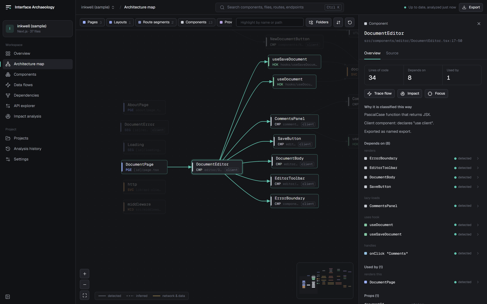
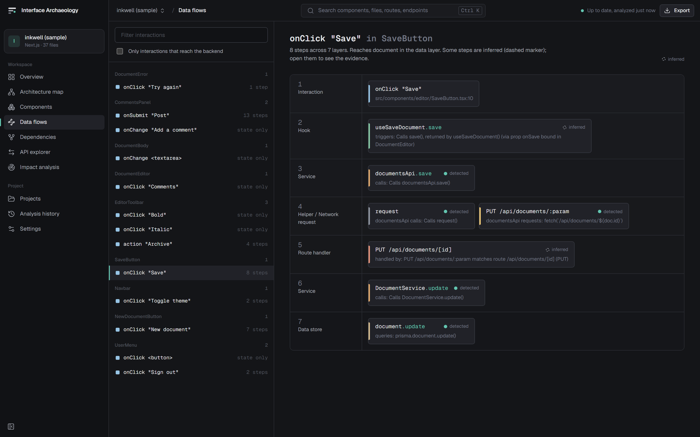
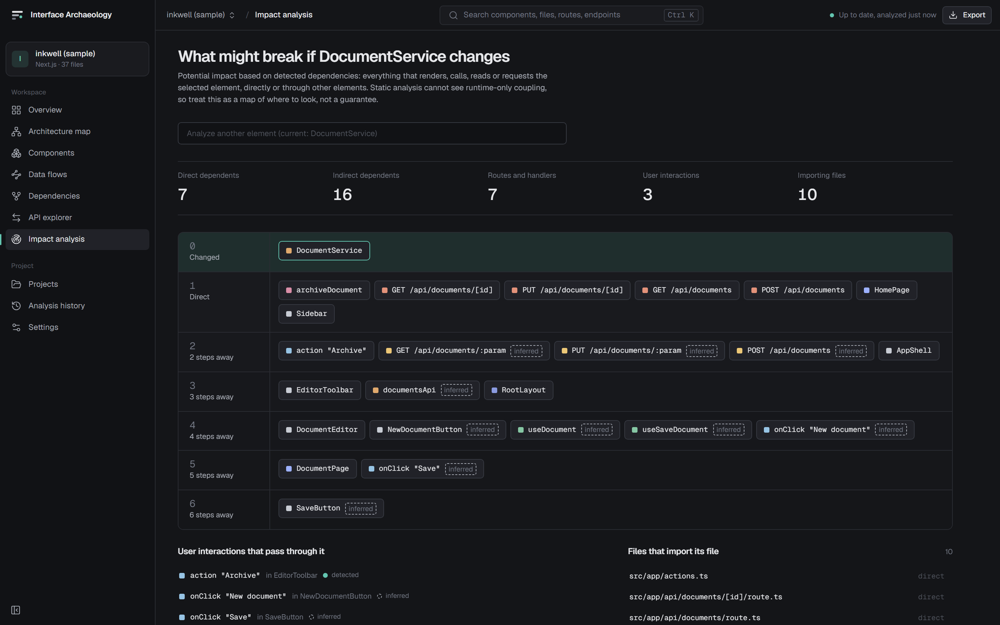
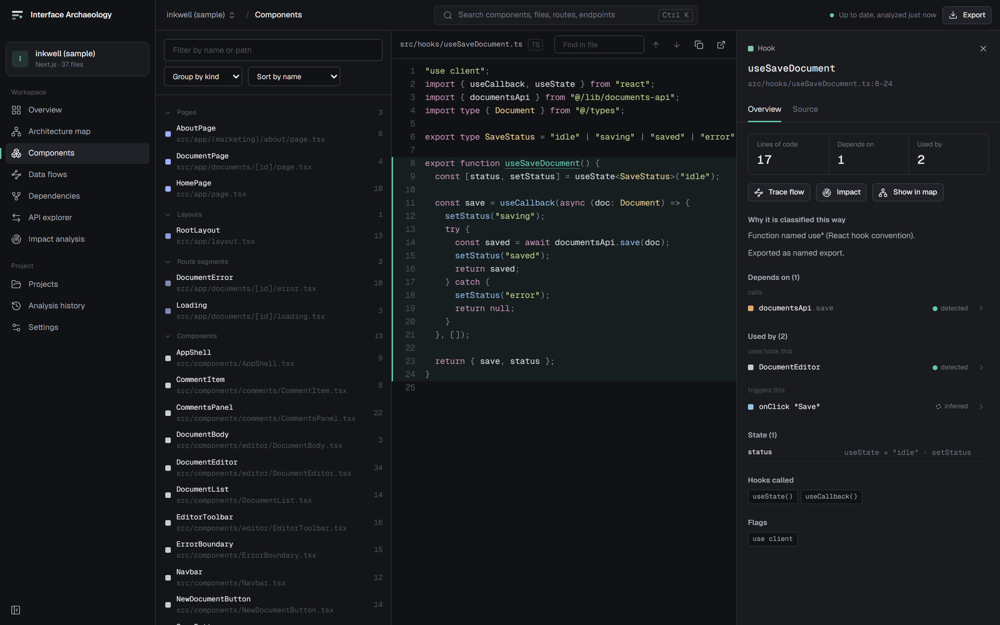
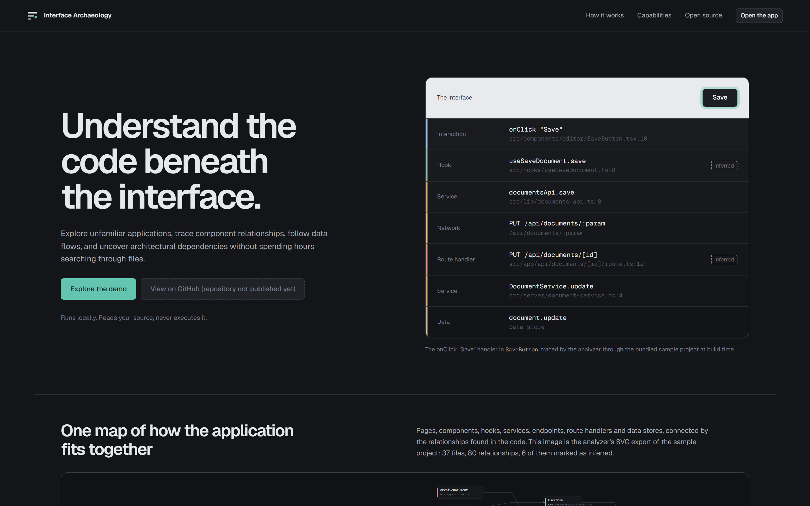

<div align="center">

# Interface Archaeology

**Understand the code beneath the interface.**

[](https://github.com/AleReyes77/interface-archaeology/actions/workflows/ci.yml)
[](LICENSE)

An interactive tool for uncovering the architecture, behaviour, data flow, dependencies and change impact of unfamiliar React and Next.js applications, built on static analysis you can verify line by line.

</div>



You join a project, or inherit one, and someone asks you to change what the **Save** button does. Interface Archaeology reads the source and answers the questions that usually take a day of grepping:

```
onClick "Save"            src/components/editor/SaveButton.tsx:10
  → useSaveDocument.save  via prop onSave, bound to DocumentEditor.handleSave   (inferred)
  → documentsApi.save     src/lib/documents-api.ts:14
  → PUT /api/documents/:param
  → PUT /api/documents/[id]   matched by URL pattern                            (inferred)
  → DocumentService.update    src/server/document-service.ts:17
  → document.update           prisma.document.update()
```

That trace is the analyzer's real output for the bundled sample project, not an illustration. Every relationship carries the file and line it was read from, and anything established by a heuristic is labelled **inferred**.

## Features

- **Architecture map.** A layered graph of pages, layouts, components, providers, contexts, hooks, services, server actions, route handlers, endpoints, data stores and packages. Pan, zoom, minimap, filtering by kind, highlighting, folder grouping, focus mode with expand-on-double-click, keyboard navigation (arrows, Escape, F to fit), and edge evidence on click.
- **Inspector.** Select anything to see its file and lines, why it was classified the way it was, props, state, hooks, event handlers, service members, network calls, data access, and every incoming and outgoing relationship with its evidence. Its Source tab shows the analyzed code with the definition highlighted.
- **Component explorer.** Browse every element by kind or folder; sort by size or dependents; read the source with the symbol highlighted; search within the file; copy; open in VS Code.
- **Data flow tracer.** Follows a UI event through handlers, props forwarded from parent components, hooks, services and HTTP requests to route handlers and the database. The result is laid out as strata, one band per layer. Gaps are shown where static analysis cannot follow the code, never filled in.
- **API explorer.** Every `fetch` and axios request with method, normalised URL, caller, request body, response handling and the Next.js route handler that serves it. Dynamic URLs and handlers with no detected caller are listed separately.
- **Dependency explorer.** File-level imports and reverse imports, fan-in and fan-out, longest import chains, cycles (Tarjan SCC, type-only imports excluded), isolated modules and package usage. Measurements and heuristics are labelled separately.
- **Impact analysis.** "What might break if I change this?" Dependents grouped by distance, each with the chain of relationships that connects it, plus affected routes, user interactions and importing files.
- **Command palette.** `Ctrl+K` / `Cmd+K` across components, hooks, services, files, routes, endpoints and commands. `g` followed by `o m c f d a i` switches views.
- **Exports.** Architecture report (Markdown), Mermaid flowchart, standalone SVG of the graph, and the full analysis as JSON.
- **History.** Every run is stored locally. Re-open older runs, compare two runs (files, elements and relationships added or removed), and see when the project has changed since the analysis you are viewing.

<table>
  <tr>
    <td></td>
    <td></td>
  </tr>
  <tr>
    <td></td>
    <td></td>
  </tr>
</table>

## Quick start

Requirements: **Node.js 22.13 or newer** (uses the built-in `node:sqlite` and TypeScript type stripping) and npm.

```bash
git clone https://github.com/AleReyes77/interface-archaeology.git
cd interface-archaeology
npm install
npm run dev
```

Open <http://127.0.0.1:4310> and choose **Explore the demo**. The bundled sample project ([`fixtures/inkwell`](fixtures/inkwell)) is analyzed with the real engine, so the demo is exactly what you get on your own code.

To analyze your own project, open **Projects** and enter the absolute path of a local directory (or use **Browse**), or paste a public HTTPS Git URL.

### Command line

The analyzer is independent of the web app and runs directly on Node:

```bash
npm run analyze -- path/to/project                      # summary
npm run analyze -- path/to/project --format markdown --out ARCHITECTURE-REPORT.md
npm run analyze -- path/to/project --format mermaid
npm run analyze -- path/to/project --format json --out analysis.json
```

## Supported today

| Area | Support |
| --- | --- |
| Languages | TypeScript, JavaScript, TSX, JSX (`.ts .tsx .js .jsx .mjs .cjs .mts .cts`) |
| React | Function, arrow, `memo`/`forwardRef`-wrapped and class components; props (from destructuring and local types); `useState`/`useReducer` state; custom hooks and the values they return; context creation, providers and consumers; event handlers; prop callbacks; conditional rendering; `Suspense`; error boundaries; `React.lazy`, `next/dynamic` and `import()` |
| Next.js | App Router (pages, layouts, loading, error, not-found, template, route handlers, route groups, dynamic and catch-all segments, parallel slots), Pages Router (pages, `_app`, API routes), `"use client"` boundary propagation (client vs. server components), server actions (`"use server"`), `middleware` and `proxy` |
| Module resolution | Relative imports, `tsconfig.json`/`jsconfig.json` `paths` and `baseUrl` (with a relative `extends`), index files, `.js` → `.ts` remapping, re-exports and barrel files |
| Network | `fetch`, `axios`, `axios.<verb>`, `axios.request`, and instances created with `axios.create({ baseURL })` across files |
| Data | Prisma-style `client.model.operation()` calls; SQL in string literals and `sql` tagged templates |

Not supported yet: Vue, Svelte, Angular, GraphQL documents, tRPC, React Router and Remix route conventions, runtime tracing. See the [roadmap](ROADMAP.md).

## How it works

```
discover → detect → parse & extract → resolve → build graph → metrics
```

1. **Discover** walks the directory without following symlinks, skips dependency and build folders, enforces file-count and file-size limits, and never opens `.env*` files.
2. **Detect** reads `package.json` and `tsconfig.json` as data to identify the framework, router and path aliases.
3. **Parse & extract** parses each file with the TypeScript compiler API (syntax only, no type checker) and records symbols plus the raw references they make: JSX elements, hook calls, calls, context reads, event handlers and their effects, network requests, data access. Results are cached by content hash, so unchanged files are not re-parsed.
4. **Resolve** maps import specifiers to project files or packages.
5. **Build graph** resolves every reference across files (through re-exports, namespaces, lazy imports and hook return values), classifies nodes, matches requests to route handlers, and follows callback props to their parents.
6. **Metrics** computes import cycles, depth, fan-in/fan-out and isolated modules.

Progress is reported per stage with measured counts; analyses can be cancelled. See [ARCHITECTURE.md](ARCHITECTURE.md) for the full design.

## Security

Imported code is treated as untrusted:

- The analyzed project is **never executed**: no scripts, no dependency installation, no builds.
- Files are read only inside the selected project root; symbolic links are not followed; `.env*` files are never read.
- Values that look like credentials (cloud keys, tokens, private keys, credential assignments, secrets in URLs) are redacted in every output, including the source viewer.
- Git import accepts only HTTPS URLs without credentials, makes a shallow clone with symlinks disabled and LFS smudging off, and fetches no submodules.
- The server binds to `127.0.0.1`. A request proxy rejects requests whose `Host` is not localhost (DNS rebinding) and cross-origin writes (CSRF from other web pages).

Report vulnerabilities as described in [SECURITY.md](SECURITY.md).

## Limitations

- This is static analysis. Runtime-only behaviour (computed import paths, reflection, string-based dispatch, event buses, URLs built from configuration) is not observed. Impact results are **potential** impact.
- Inferred relationships rely on heuristics: URL pattern matching between requests and route handlers, prop-callback forwarding, and HTTP clients identified by name when their definition cannot be resolved.
- Types are not checked, so calls through values whose type matters (for example a function received as an argument) are not resolved.
- Very large repositories are bounded by the configurable file limit (5,000 files by default). Above roughly 250 visible nodes the map suggests filtering or focus mode.

## Development

```bash
npm run dev          # app at http://127.0.0.1:4310
npm test             # unit + integration tests (Vitest)
npm run test:e2e     # end-to-end tests (Playwright; run `npm run build` first)
npm run typecheck
npm run lint
npm run build
npm run screenshots  # regenerate docs/screenshots from a production build
```

Local data (projects, analysis history, the extraction cache and Git clones) lives in `.data/`. Set `IA_DATA_DIR` to store it elsewhere. Forks can set `NEXT_PUBLIC_REPOSITORY_URL` to point the landing page's GitHub links at their own repository.

## Contributing

Contributions are welcome: new detectors, framework conventions, fixtures and exports in particular. Read [CONTRIBUTING.md](CONTRIBUTING.md) first.

## License

[MIT](LICENSE)
